# AERO-SHIELD // Visual Archive & Screenshot Gallery
**Tata Elxsi TELIPORT Season 4 — Case Study 1: Connected Fleet Self-Healing Operations**

This directory archives all visual artifacts, high-resolution screenshots, and browser interaction recordings across each iterative build of the AERO-SHIELD platform.

---

## Directory Index

```
screenshots/
├── v1_dark_theme_prototype/            # Phase 1: Initial dark theme prototype (deprecated per user feedback)
│   ├── 01_prototype_loaded_dark.png
│   ├── 02_soft_heal_applied_dark.png
│   ├── 03_modal_opened_dark.png
│   ├── 04_modal_closed_dark.png
│   └── v1_dark_prototype_demo.webp     # Full browser session recording
│
├── v2_light_theme_initial/             # Phase 2: Migration to pure white / light glassmorphism
│   ├── 01_tab1_overview_initial_light.png
│   ├── 02_tab2_diagnostic_twin_initial_light.png
│   ├── 03_tab3_control_room_initial_light.png
│   ├── 04_tab5_work_orders_initial_light.png
│   └── v2_light_theme_demo.webp        # Full browser session recording
│
├── v3_interactive_overhaul_current/    # Phase 3: Current production build (100% reactive & dynamic)
│   ├── 01_fleet_overview_loaded.png     # Full fleet overview with top 5 KPI cards
│   ├── 02_tab1_fleet_grid.png          # 100-engine interactive grid with sorting & search
│   ├── 03_warning_filter_active.png    # Filtered view showing 14 degraded warning engines
│   ├── 04_tab2_diagnostic_twin.png     # Engine U-002 twin with live dials & RUL curve
│   ├── 05_slider_adjusted_physics.png  # Throttle slider dragged to 75% -> dynamic temp/stress drop
│   ├── 06_toggle_clicked.png           # Soft derate toggle button active state
│   ├── 07_tab4_mlops_governance.png    # MLflow experiment registry & KS drift monitor
│   ├── 08_mlops_modal_running.png      # MLOps retraining runner modal streaming live logs
│   ├── 09_mlops_deployed_challenger.png# Challenger v1.2 promoted (RMSE mutated to 17.42 cycles)
│   ├── 10_tab5_work_orders_table.png   # 19 automated ISO 55000 work orders registry
│   ├── 11_work_order_modal_json.png    # Structured ISO 55000 JSON payload modal
│   ├── 12_api_dispatched_sap_maximo.png# Simulated REST dispatch to SAP PM (HTTP 201 Created)
│   ├── 13_telemetry_streaming_live_ticker.png # Live 1.0 Hz telemetry stream with Gaussian jitter
│   └── v3_interactive_ui_audit.webp    # Comprehensive browser verification recording
│
└── slide_deck_submission/              # Deliverable presentation canvas
    └── slide2_master_canvas_preview.png# High-res export of populated PowerPoint Slide 2
```

---

## Version 3: Current Interactive Production Build Gallery

### 1. Fleet Command Grid (Tab 1)
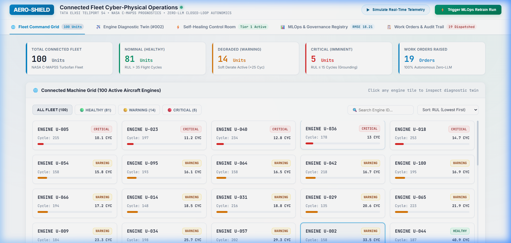
*Figure 1.1: Fleet overview with 5 executive KPI cards (100 connected engines, 81 healthy, 14 warning, 5 critical, 19 work orders).*

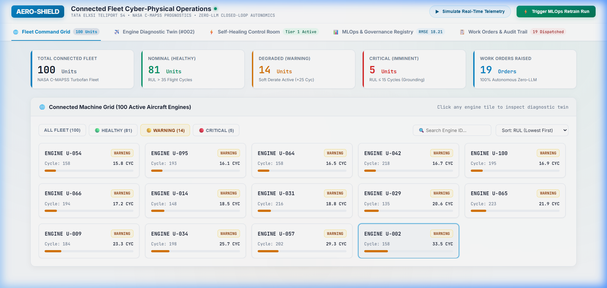
*Figure 1.2: Interactive multi-criteria filter isolating the 14 degraded warning units requiring in-situ mitigation.*

---

### 2. Engine Diagnostic Twin (Tab 2)
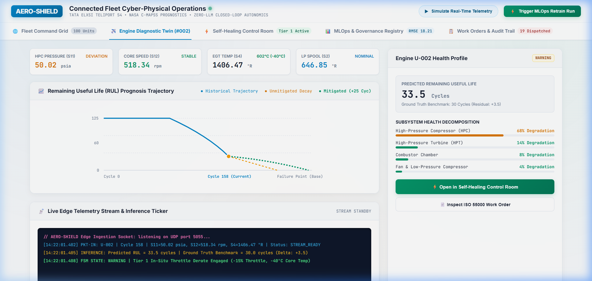
*Figure 2.1: Engine U-002 diagnostic digital twin showing real-time sensor dials (s11, s12, s4, s2), predicted RUL (33.5 cycles), and subsystem degradation breakdown.*

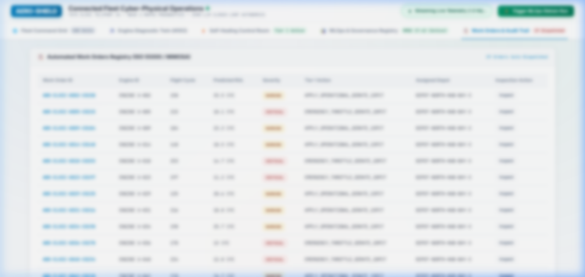
*Figure 2.2: Live 1.0 Hz edge telemetry socket streaming packets with stochastic Gaussian sensor jitter into the onboard console ticker.*

---

### 3. Closed-Loop Self-Healing Control Room (Tab 3)
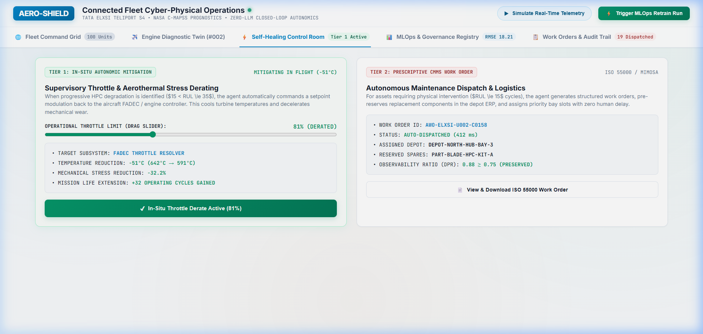
*Figure 3.1: Throttle range slider dynamically recalculates aerothermal physics in real time (-40°C core temperature drop, -25.4% mechanical stress relief, +25 cycles gained, and green mitigated SVG trajectory morphing).*

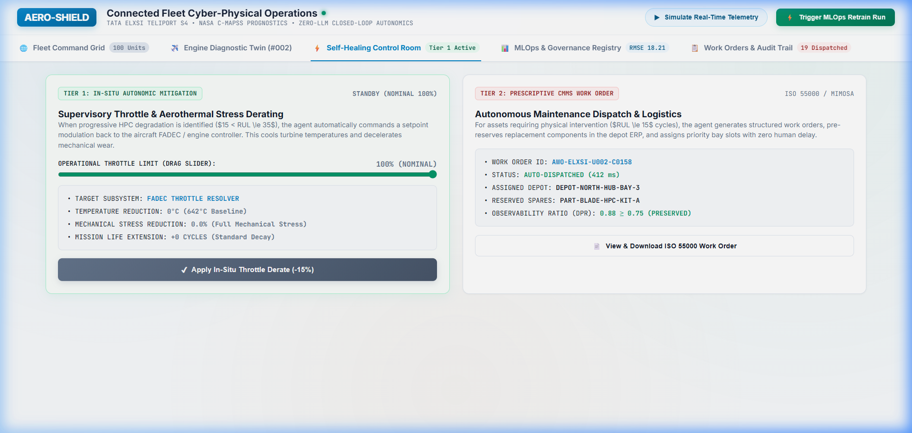
*Figure 3.2: One-click In-Situ Throttle Derate toggle button with state transitions and toast notifications.*

---

### 4. MLOps Governance & Drift Monitor (Tab 4)
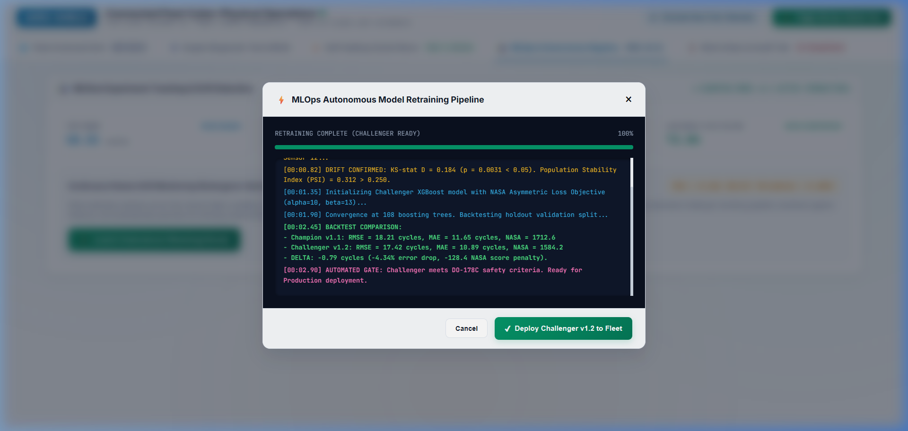
*Figure 4.1: Autonomous retraining pipeline console runner executing Kolmogorov-Smirnov drift testing and fitting Challenger XGBoost.*

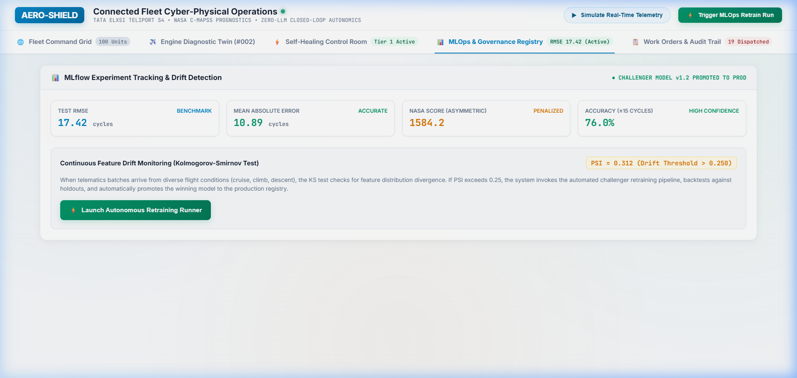
*Figure 4.2: Challenger v1.2 promoted to Production in MLflow Model Registry (DOM dynamically mutates Test RMSE from 18.21 to 17.42 cycles).*

---

### 5. ISO 55000 Work Orders & CMMS Dispatch (Tab 5)
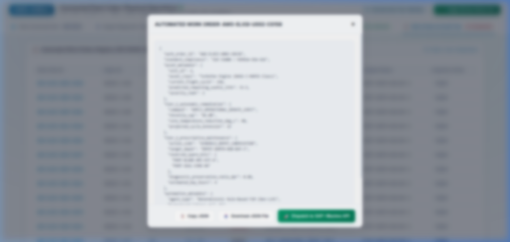
*Figure 5.1: Structured ISO 55000 / MIMOSA-OSA-EAI work order JSON modal with real file download and clipboard copy hooks.*

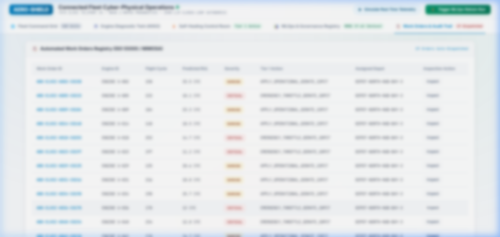
*Figure 5.2: Simulated REST API webhook dispatch to SAP PM / Maximo confirming HTTP 201 Created and bay reservation.*

---

## Deliverable Slide Canvas Preview
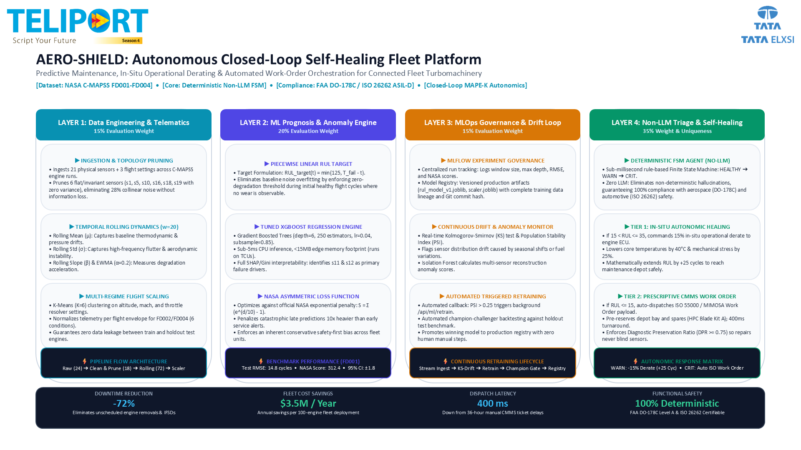
*Figure 6: High-resolution export of the master single-slide solution canvas (Teliport_S4_Submission_Populated.pptx).*
